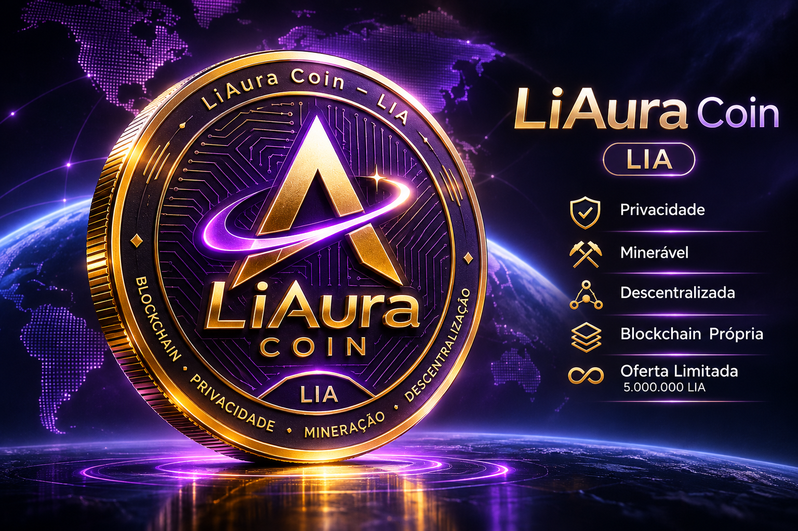
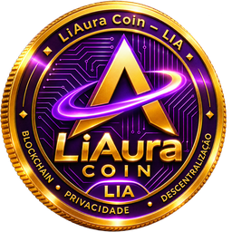

<p align="center">
  
</p>

<p align="center">
  
</p>

# LiAura Coin (LIA)

Criptomoeda baseada em privacidade (CryptoNote / RingCT / CLSAG / Bulletproofs+ / View Tags), com cronograma unificado `v1..v16` e emissão transparente e auditável.

## Política Monetária Transparente

- **Oferta máxima:** `5.000.000 LIA` (12 casas decimais, sem *tail emission*)
- **Reserva de mineração (95%):** `4.750.000 LIA`
- **Reserva dos fundadores (5%):** `250.000 LIA` distribuídos em **24 parcelas** a cada **43.800 blocos** (bloco `43.800` ao bloco `1.051.200`)
- **Identidade Mainnet:** Prefixo `0x114`, P2P `19080`, RPC `19081`, `GENESIS_TX="013c01ff000000"`, `GENESIS_NONCE=10000`

## Manifesto SHA-256 (Release Determinístico A/B)

| Binário | SHA-256 |
|---|---|
| `liaurad` | `3379849b1a379944bb2c39898d9840a2347aae8e058d8345fa2a7f4f8a8c5f4e` |
| `liaura-wallet-cli` | `1c4a1b755459f3fbe37a9c98a6aece50acb3a268f3054dbfe98f0c3367527043` |
| `liaura-wallet-rpc` | `e4b49b3fb29e6615eadbc3ac3058b04c2a427ad1acc797aaf40dddf6a3c03df2` |

## Compilação Rápida (Determinística)

```bash
export SOURCE_DATE_EPOCH=$(git -C liaura-src log -1 --format=%ct)
cmake -S liaura-src -B build-release \
  -DCMAKE_PREFIX_PATH=/mnt/RASEC-PROJETOS/LIAURA-COIN/deps-install \
  -DMANUAL_SUBMODULES=1 \
  -DLIAURA_RELEASE_BUILD=ON
cmake --build build-release --target daemon simplewallet wallet_rpc_server -j16
```

## Nó, Carteira e Mineração

```bash
# Iniciar daemon
./liaurad --p2p-bind-port 19080 --rpc-bind-ip 127.0.0.1 --rpc-bind-port 19081

# Iniciar mineração solo
./liaurad --start-mining <SEU_ENDERECO_LIA> --mining-threads 4

# Iniciar RPC da carteira
./liaura-wallet-rpc --rpc-bind-port 19085 --daemon-address 127.0.0.1:19081 --wallet-dir ./wallets
```

## Ecossistema LiAura — O que estamos construindo

A **LiAura Coin (LIA)** é uma criptomoeda com blockchain própria, desenvolvida para integrar futuramente softwares, serviços digitais e jogos.

Nosso objetivo é construir um ecossistema em que a LIA tenha aplicações práticas.

### Softwares LiAura

Estamos desenvolvendo aplicações que poderão ser adquiridas em reais (BRL) ou utilizando LIA, com descontos especiais para pagamentos realizados com nossa criptomoeda.

**Previsão de disponibilização:**
- Primeiro software: até o final da próxima semana.
- Segundo software: na sequência, conforme a conclusão dos testes.

Essas datas são metas de desenvolvimento e podem sofrer alterações.

### MMORPG LiAura

Também estamos desenvolvendo um MMORPG que fará parte do ecossistema LiAura.

Planejamos permitir que jogadores utilizem LIA para adquirir itens cosméticos e personalizações visuais, sem comprometer o equilíbrio competitivo do jogo.

O jogo permanece em desenvolvimento e ainda não possui data oficial de lançamento.

### Nossa visão

Queremos que a LiAura Coin seja mais do que uma moeda digital: uma forma de conectar nossos softwares, jogos e futuros serviços.

**A blockchain e a carteira já foram disponibilizadas publicamente. As integrações comerciais e o MMORPG ainda estão em desenvolvimento.**
